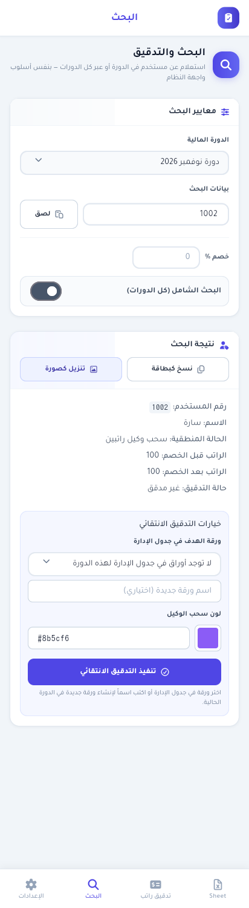
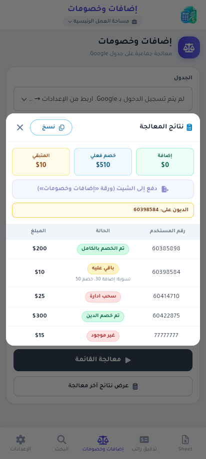

# تدقيق لورك — تدقيق الرواتب على الهاتف

تطبيق Flutter لـAndroid ينفّذ **نفس نظام التدقيق الموجود في LorkERP، بنفس المنطق ونفس الواجهة**، لكن الحساب يتم على الهاتف بدل الخادم السحابي. يتصل التطبيق بحساب Google مباشرة من الهاتف (بدون خادم)، ويمكن استخدامه أيضًا بدون Google من ملفات Excel / CSV.

## الأقسام (مثل ERP)

| القسم | يقابل في ERP | ماذا يفعل |
| --- | --- | --- |
| **Sheet** | `views/partials/sheet.ejs` | الدورات المالية: إنشاء دورة من Google Sheets (جدول وورقة للإدارة وللوكيل) أو برفع ملفين، تعديل، حذف، شارة «مرتبطة بـ Google / ملفات محلية». |
| **تدقيق راتب** | `views/partials/payroll-google.ejs` | اختيار الدورة ← «تحميل الدورة» (مزامنة من Google) ← جدول معلومات المستخدمين ← الأعمدة ← الخصم والألوان ← «تدقيق». نفس شريط جلسة التدقيق (إغلاق / إعادة فتح)، ونفس نتيجة التدقيق والتشخيص وعينات الأرقام. |
| **إضافات وخصومات** | `views/partials/member-adjustments.ejs` | المعالجة الجماعية فقط على جدول Google: الجدول والورقة، أعمدة ID والراتب والحالة (C / L / O)، لصق القائمة (رقم ← نوع ← مبلغ، و«خصم كامل»)، ثم نافذة النتائج (إضافة، خصم فعلي، المتبقي، الديون على، الجدول، «نسخ»). بدون الفردي وبدون «التسجيل المحاسبي المتقدم». منفصل عن التدقيق. |
| **البحث** | `views/partials/search.ejs` | البحث برقم المستخدم داخل دورة أو في كل الدورات، الحالة المنطقية، الراتب قبل/بعد الخصم، حالة التدقيق، التدقيق الانتقائي لمستخدم واحد، نسخ البطاقة أو حفظها كصورة. |
| **الإعدادات** | الإعدادات ← Google Sheets | ربط حساب Google أو فصله، مساحات العمل، وأعمدة كل مساحة. |

**مساحات العمل:** من القائمة في البار العلوي (تحت عنوان الصفحة) تنتقل بين المساحات أو تضيف مساحة جديدة.

## منطق التدقيق

المحرك في `lib/erp/` منقول سطرًا بسطر من `services/payrollAuditEngine.js` و`services/payrollSearchService.js`، بما في ذلك سلوك JavaScript الدقيق (`parseFloat` و`Math.floor` و`Math.round` وترتيب `Object.keys`):

| المطابقة | النوع | الحالة المكتوبة | الراتب |
| --- | --- | --- | --- |
| إدارة + صف وكيل واحد | سحب وكالة | سحب وكيل | مجموع راتب الوكيل بعد الخصم |
| إدارة + أكثر من صف وكيل | سحب وكالة - راتبيين | سحب وكيل راتبين | مجموع الرواتب بعد الخصم |
| إدارة فقط | سحب إدارة | سحب ادارة | 0 |
| غير ذلك | غير موجود | غير موجود | 0 |

**رابط جدول:** في أي قائمة جداول يمكن اختيار «🔗 لصق رابط جدول Google…» ولصق رابط الجدول مباشرة بدل البحث في القائمة.

**بدون Google:** اختر «📁 ملف من الجهاز» في جدول معلومات المستخدمين. يُحسب التدقيق بنفس المحرك وتُحفظ نفس الآثار (أوراق الوجهة، الألوان، عمود الراتب والحالة) في ملف عمل على الهاتف، ثم «تصدير النتائج إلى Excel».

### مطابقة ERP خطوة بخطوة

| في ERP | في التطبيق |
| --- | --- |
| زر «تدقيق»: `1/2 مزامنة` (`POST /cycles/:id/sync` مع جدول معلومات المستخدمين) ثم `2/2 تطبيق` (`POST /payroll-execute`) | نفس الخطوتين ونفس الرسائل؛ إذا فشلت المزامنة يتوقف التدقيق. الدورة غير المرتبطة بـ Google لا تُدقق على Google (نفس رسالة ERP). |
| `payroll-execute` | منقول كاملًا في `lib/services/payroll_service.dart`: مزامنة الدورة، رفض المعرّفات المكررة، حارس «لم يتغيّر الجدول» (بدون زر إجبار كما في واجهة ERP)، أوراق الوجهة من عمود اسم الورقة، النسخ، عمود الراتب والحالة، التلوين بدفعات 8 طلبات كل 1.5 ثانية، حفظ الحالات وكاش البحث وبصمة الجدول. |
| «تحميل الدورة» | مزامنة الدورة ثم إعادة الأعمدة إلى A / A / D، بعناوين الأعمدة للدورات المرتبطة وأحرف فقط للدورات من ملفات. |
| المزامنة الخلفية `cycleSyncWorker` (كل دقيقتين، الكاش صالح 5 دقائق، مقفلة افتراضيًا `sync_enabled`) | نفسها أثناء فتح التطبيق، وتُفعّل من الإعدادات ← «المزامنة التلقائية للدورات». |
| البحث يقرأ كاش الدورة فقط، الصف الأول عنوان (`slice(1)`)، الاسم من العمود B | نفس السلوك ونفس الرسائل («لم يتم مزامنة الدورة بعد…»). |
| التدقيق الانتقائي `execute-audit-advanced` | نفس الخطوات: ورقة هدف موجودة أو جديدة، إلحاق صف الإدارة، تلوينه، تلوين صفوف الإدارة والوكيل الأصلية، حالة «تدقيق من أداة البحث». |
| رفع ملفات Excel/CSV للدورة | Excel: الورقة الأولى. CSV: نفس محلل ERP (فاصلة أو Tab، علامات اقتباس، حذف الأسطر الفارغة، قص المسافات). |

**ما لا يُنقل (باختيار المالك):** العمليات المحاسبية التي ينفّذها ERP مع التدقيق: مزامنة الوكالات الفرعية وأرباحها، رصيد الصندوق، المؤجل، ترحيل الأرباح، ملف العضو، وقيود الاعتماد عند إنشاء الدورة.

### أخطاء ERP المصلحة (بموافقة المالك)

1. **البحث في كل الدورات:** في ERP يخرج المسار عند أول دورة لا يظهر فيها المستخدم دون أن يرد (الطلب يتعلق). هنا يكمل على كل الدورات.
2. **المزامنة الخلفية والتدقيق اليدوي:** ERP يضع كل أرقام ورقتي الإدارة والوكيل في مجموعة «الملوّن»، فيظهر الجميع «مدقق يدوي». القاعدة الموثقة في خطة ERP هي الوجود + لون الصف؛ هنا يُعدّ الصف ملوّنًا إذا كانت خلفية خلية رقم المستخدم غير بيضاء.
3. **منع تكرار النسخ في أوراق الوجهة الموجودة:** في ERP يستدعي الكود `isHeaderRow` غير المعرّفة في `routes/sheet.js` فيُبتلع الخطأ ولا تُقرأ الأرقام الموجودة. هنا تُقرأ ويُتجنب التكرار كما قصد الكود.
4. **التدقيق الانتقائي لصف موجود مسبقًا:** ERP يعود بنجاح قبل التلوين وكتابة الحالة. هنا لا يُكرر الصف لكن يكمل التلوين والحالة.
5. **التدقيق الانتقائي وأول صف في ورقة الوجهة:** ERP يتخطى الصف الأول دائمًا مع أن التدقيق الجماعي يكتب أوراق الوجهة بلا عنوان، فقد يتكرر أول مستخدم. هنا يُتخطى فقط إذا كان عنوانًا.
6. **مطابقة جزئية:** ERP يستعمل `indexOf` في البحث داخل الدورة وفي تلوين التدقيق الانتقائي (مثلًا 123 يطابق 51234). هنا مطابقة كاملة.
7. **أعمدة البحث:** ERP لا يحفظ أعمدة الدورة أبدًا (`saveCycleColumns` لا تُستدعى) فيبحث دائمًا في A / A / D، ويقرأ حرفًا واحدًا فقط. هنا تُحفظ أعمدة آخر تدقيق وتدعم AA وما بعده.
8. **دورة يُنشأ لها جدول Google داخل `payroll-execute`:** ERP يلوّن الورقة الأولى بدل «الوكيل». (هذا المسار لا يُستدعى من واجهة ERP ولا من التطبيق، ومنقول للاكتمال.)
9. **قراءة الأوراق على دفعات:** ERP يتوقف عند أول دفعة (5,000 صف) تعود ناقصة، وGoogle يحذف الصفوف الفارغة في آخر كل نطاق، فتضيع كل الصفوف بعد فراغ يقع على حدود دفعة. هنا تُقرأ الدفعات حتى عدد صفوف الورقة وتبقى الصفوف في مواضعها.

### طلبات المالك المختلفة عن ERP (2026-11-17)

1. **التدقيق يكمل في الخلفية ويُستأنف:** تدقيق Google يُحفظ كمهمة على الهاتف (`audit_jobs`): المزامنة والقراءة والحساب مرة واحدة، ثم خطوات الكتابة (إنشاء الأوراق، النسخ لكل ورقة، الراتب، الحالة، تلوين الإدارة، تلوين الوكيل، الحفظ) وكل خطوة تُسجَّل عند اكتمالها. تبدأ المهمة فورًا داخل التطبيق، ويتابعها Android WorkManager (خدمة أمامية `dataSync` بإشعار «جاري تنفيذ التدقيق») إذا أُغلق التطبيق، ولا تعمل إلا مع وجود الإنترنت. عند انقطاع الاتصال تُعاد المحاولة ثم تنتظر وتُستأنف من الخطوة نفسها؛ خطوة النسخ تقرأ ورقة الوجهة قبل الكتابة فلا يتكرر صف حتى لو ضاع رد Google. قفل في قاعدة البيانات يمنع تشغيل المهمة من مكانين معًا.
2. **التلوين دفعة واحدة:** بدل دفعات ERP (8 طلبات كل 1.5 ثانية) يُرسل تلوين كل ورقة في طلب واحد، والصفوف المتتالية بنفس اللون تُدمج في نطاق واحد.
3. **الأرقام المكررة في جدول معلومات المستخدمين:** ERP يرفض التدقيق كله. هنا يكمل التدقيق: أول صف لكل رقم يُدقق ويُنسخ مرة واحدة فقط، والصفوف الأخرى لا تُنسخ ويُكتب فيها «مكرر (الصف N)» بلا راتب، وتظهر قائمة المكررات (الرقم والصفوف) أثناء التدقيق وفي النتيجة.

4. **غير المدققين في ورقة الوكيل (2026-11-17):** في قسم «أدوات بعد التدقيق» (يظهر بعد «تحميل الدورة»، أي بعد تدقيق كامل أو جزئي) زر «عرض غير المدققين في ورقة الوكيل». يفتح نافذة منبثقة بأرقام ورقة الوكيل التي ليس لها حالة «مدقق» في الدورة (رقم المستخدم من عمود الوكيل A، والاسم من العمود C)، مع العدد المتبقي، وبحث، و«نسخ الكل» (الرقم والاسم مفصولين بـTab) أو «نسخ الأرقام فقط». للقراءة فقط: لا يكتب على Google ولا يغيّر أي حالة.
5. **بلا حد لعدد الصفوف (2026-11-17):** أُزيل حد ERP البالغ 150,000 صف عند القراءة؛ تُقرأ الأوراق على دفعات حتى آخر صف في الورقة؛ النسخ والكتابة الكبيرة تُرسل على أجزاء (5,000 صف للنسخ و20,000 لعمودي الراتب والحالة)؛ وبيانات الأوراق والخطط تُحفظ على الهاتف مقسّمة لأن Android لا يقرأ قيمة SQLite أكبر من 2 ميغابايت. اختُبر حفظ 40,000 صف (أكثر من 2 ميغابايت) واسترجاعه.

6. **«١. تدقيق غير المذكورين» (2026-11-17):** زر في «أدوات بعد التدقيق». أرقام ورقة الوكيل غير الموجودة في جدول معلومات المستخدمين تُضاف إليه، كل رقم مرة واحدة حتى لو له أكثر من صف (أكثر من راتب)، في صفوف جديدة بعد آخر صف: الرقم في العمودين A وC، و«غير مذكور» في D وE. ثم تُدقق هذه الصفوف وحدها بنفس منطق التدقيق: العمود D يوجّه النسخ إلى ورقة «غير مذكور» في جدول الإدارة، ويُكتب الراتب والحالة وتُلوّن الصفوف. لا تتغير الصفوف الموجودة. مواضع الصفوف الجديدة تُحدد مرة واحدة، فإعادة الخطوة بعد انقطاع الإنترنت تكتب نفس الخلايا؛ وإذا كتب أحد في تلك الصفوف أثناء الانتظار تتوقف العملية بدل الكتابة فوقها. وإذا لم تتسع الورقة تُضاف لها صفوف.
7. **«٢. سحب صفوف الإدارة غير الملوّنة إلى «غير مذكور»» (2026-11-17):** صفوف ورقة الإدارة التي خلفية خلية رقمها غير ملوّنة، وليست مدققة في التطبيق، وصاحبها غير موجود في جدول معلومات المستخدمين، وفيها مبلغ غير صفري في العمود W (مبلغ الوكيل الفرعي؛ يُقبل `2.0` و`8٫05` والأرقام العربية) تُنسخ كاملة إلى ورقة «غير مذكور» في جدول الإدارة (تُنشأ إن لم تكن موجودة)، ثم تُلوّن بلون الإدارة وتُسجَّل «مدقق» حتى لا تُسحب مرة ثانية. الصفوف التي W فيها صفر أو فارغ لا تُنقل. يُفضّل تنفيذ «١» قبلها.

   الأداتان مهمتان في الخلفية مثل التدقيق (تكملان بعد إغلاق التطبيق وتُستأنفان بعد انقطاع الإنترنت)، وتطلبان تأكيدًا قبل الكتابة، وتعملان على جداول Google فقط.
8. **مساحات العمل (2026-11-17):** أكثر من مساحة عمل في نفس التطبيق (مثلًا شركة ثانية)، لكل منها دوراتها وتدقيقها وإعداداتها وأعمدتها في قاعدة بيانات مستقلة على الهاتف، وحساب Google مشترك. التنقل من قائمة في البار العلوي؛ الإضافة والتسمية والحذف من الإعدادات أو من نفس القائمة. المساحة الرئيسية تستخدم قاعدة البيانات الأصلية (`erp_audit.db`) فلا تتغير بيانات النسخ السابقة، والمساحات الجديدة `erp_audit_wsN.db` وقائمتها في `workspaces.db`. التدقيق الجاري في مساحة يكمل عند الانتقال إلى أخرى، والعامل الخلفي يكمل مهام كل المساحات.
9. **أعمدة لكل مساحة (2026-11-17):** الإعدادات ← «أعمدة …»: أعمدة جدول معلومات المستخدمين (رقم المستخدم C، اسم الوكالة D، الراتب L، الحالة تلقائي)، الإدارة (رقم المستخدم A، مبلغ الوكيل الفرعي W)، الوكيل (رقم المستخدم A، الراتب D، الاسم C)، ونص «غير مذكور» وأعمدته الإضافية (A للرقم، E للنص). القيم الافتراضية هي الأعمدة السابقة؛ الحفظ يطبّقها فورًا على صفحة التدقيق، ويمكن تغييرها في أي وقت. لا يُسمح بإعدادات تكتب الرقم أو النص فوق عمود الراتب أو الحالة.
11. **اسم وكالة فارغ يذهب إلى «غير مذكور» (2026-11-17):** في التدقيق (الجماعي ومن ملف على الهاتف و«تدقيق غير المذكورين») المستخدم الذي عمود اسم الوكالة (D) عنده فارغ يُدقق كالمعتاد ويُنسخ إلى ورقة «غير مذكور» في جدول الإدارة (نص «غير مذكور» من أعمدة المساحة). ERP كان ينشئ لكل صف كهذا ورقة باسم «صف_N». العمود D نفسه لا يُكتب فيه شيء. وإذا كتب المالك «غير مذكور» بنفسه في D (ولو مع علامات اتجاه غير مرئية أو مسافات زائدة من النسخ) تذهب الصفوف إلى نفس الورقة، فالمكتوب والمنسي يُعاملان مثل بعض ولا تُنشأ ورقة ثانية.
12. **إضافات وخصومات (2026-11-17):** نقل `services/memberAdjustmentSheetOps.js` (المعالجة الجماعية) كما هو: قراءة الأسطر (Tab أو مسافات)، أول صف للرقم، `computeSheetOp` (خصم، خصم كامل «تم خصم الدين»، راتب صفر «سحب ادارة»، «باقي عليه» إذا بقي دين 1 أو أكثر، وأي نوع غير «خصم» إضافة)، كتابة الراتب بمنزلتين والحالة «تم خصم X» / «تم اضافة X»، وملخص ERP ونص النسخ. قورنت النسخة بكود ERP نفسه على 600 قائمة عشوائية: لا اختلاف. **تعديل المالك:** إذا جاء رقم واحد بإضافة وخصم في القائمة نفسها تُجمع عملياته أولًا في تسوية (الإضافات ناقص الخصومات) تُطبَّق مرة واحدة مكان أول سطر له، ويُكتب في عمود الحالة «تم خصم 20 (تسوية: إضافة 30، خصم 50)» أو «تم اضافة …» أو «تمت التسوية (…)» إذا كان الصافي صفرًا. سبب ذلك أن ERP يطبّق الأسطر بالترتيب: راتب 10 ثم خصم 50 ثم إضافة 30 يعطي راتبًا 30 ودينًا 40، والصحيح راتب 0 ودين 10. «خصم كامل» لا يدخل في التسوية. المعالجة مهمة في الخلفية مثل التدقيق: تُحسب كلها أولًا ثم تُكتب الخلايا دفعة واحدة (حتى 1,000 صف في الطلب)، وتُستأنف بعد انقطاع الإنترنت دون تكرار أي خصم أو إضافة. وإذا تغيّر راتب في الورقة أثناء الانتظار تتوقف قبل الكتابة.

    **«دفع إلى الشيت» (2026-11-17):** زر في نافذة النتائج بجانب «نسخ». يكتب النتائج في ورقة جديدة «إضافات وخصومات» في نفس الجدول، كما يلصقها المالك يدويًا: الأسطر الملصوقة في A–C (رقم، نوع، مبلغ، والأسطر الفارغة تبقى فارغة)، D فارغ، ونتيجة كل سطر بجانبه في E–G كما ينسخها «نسخ». سطر دُمج في تسوية يُكتب بجانبه «ضمن التسوية (الصف N)». تحتها المجاميع الثلاثة، وبعد خمسة صفوف جدول المستخدمين الذين تمت تسويتهم (رقم المستخدم، الإضافة، الخصم، الصافي) بحدود. إذا كانت الورقة موجودة من معالجة سابقة تُنشأ «إضافات وخصومات 2» وهكذا؛ وإذا انقطع الاتصال أثناء الكتابة تُعاد في نفس الورقة دون إنشاء ورقة ثانية. بعد الكتابة يصبح الزر «فتح ورقة …».
10. **أيقونة التطبيق (2026-11-17):** تصميم المالك: أيقونة Android بكل الكثافات، Adaptive Icon (الشعار فوق تدرج الأزرق-الأخضر، مع شكل أحادي اللون لأيقونات Android 13)، شاشة البدء، والشعار في رأس التطبيق. الهوية في [`docs/brand`](docs/brand/README.md).

**إضافات لا تغيّر منطق ERP:** التدقيق من ملف على الهاتف بدون Google مع تصدير Excel، خيار «لصق رابط جدول Google»، وحصر التلوين في عدد أعمدة الورقة الفعلي بدل 200 حتى لا يرفض Google النطاق.

## التنزيل

آخر نسخة موقّعة: [`releases/lork-audit-2.5.2.apk`](releases/lork-audit-2.5.2.apk) — الإصدار 2.5.2 (versionCode 11)، SHA-256 `a99ae53611b6ba10a59bff91173b3763bb6eefb4d7840ea3a81a0a95a7cf9411`. تُثبَّت كتحديث فوق أي نسخة سابقة من التطبيق.

## البناء

- **GitHub Actions:** `.github/workflows/build-apk.yml` يبني APK Release موقّعًا عند الدفع إلى `main` أو `ccr-*` أو يدويًا، ويرفعه باسم `lork-audit-apk` في صفحة التشغيل.
- **محليًا:** Flutter 3.50.0 وJDK 21 وAndroid SDK:

```sh
flutter pub get
flutter analyze
flutter build apk --release
```

معرّف التطبيق `cloud.lork.audit.standalone`، الإصدار `2.5.2+11` (يُثبَّت كتحديث فوق الإصدارات السابقة بنفس مفتاح التوقيع؛ يرقّي قاعدة البيانات تلقائيًا). تستخدم النسخة 2 قاعدة بيانات جديدة `erp_audit.db`؛ بيانات 1.0.0 (`audit.db`) تبقى على الجهاز دون استخدام. راجع [مرجع التوقيع وGoogle OAuth](docs/RELEASE_SIGNING.md) و[حالة التحقق](docs/VALIDATION.md).

## الهيكلية

```
lib/
  erp/        محرك التدقيق المنقول من ERP + توافق أرقام JavaScript
  google/     تسجيل الدخول وواجهة Google Sheets/Drive (REST) + إعادة المحاولة
  data/       SQLite على الهاتف، استيراد Excel/CSV، تصدير Excel
  services/   الدورات، التدقيق الجماعي (payroll-execute)، أدوات «غير مذكور»، الإضافات والخصومات، البحث والتدقيق الانتقائي
  background/ العامل الخلفي (WorkManager) لمهام كل مساحات العمل
  ui/         واجهة مطابقة لـERP (Tajawal، ألوان Tailwind، نفس الحقول والنصوص)
test/         اختبارات المحرك (قيم مأخوذة من JavaScript الخاص بـERP) والخدمات مع Google وهمي ومساحات العمل
docs/brand/   الأيقونة والشعار والألوان
tool/         gen_icons.py: توليد الأيقونات من صورتي المالك
```

## لقطات

لقطات من نسخة سطح مكتب للمعاينة مبنية من نفس الكود (بيانات تجريبية؛ «تدقيق راتب» بعد تدقيق محلي من ملف CSV):

| تدقيق راتب | Sheet | البحث |
| --- | --- | --- |
|  |  |  |

| أدوات بعد التدقيق (2.4.0) | قائمة مساحات العمل | الإعدادات: المساحات والأعمدة |
| --- | --- | --- |
|  |  |  |

| إضافات وخصومات (2.5.0) | نتائج المعالجة |
| --- | --- |
|  |  |
